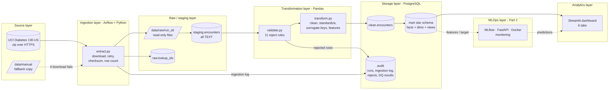
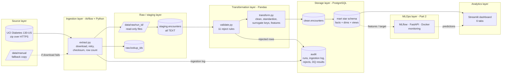
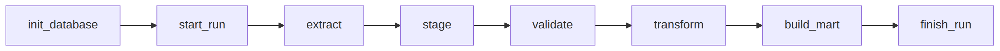
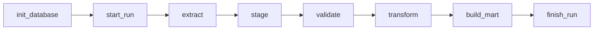
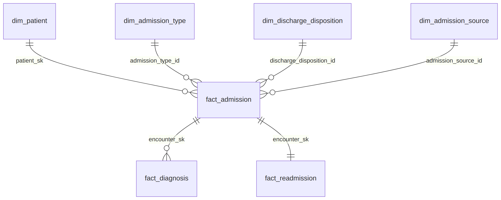
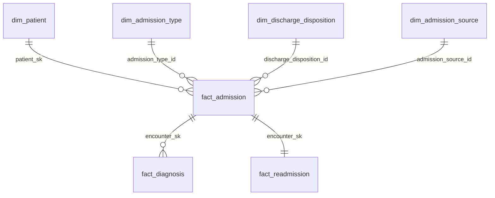

# Architecture and pipeline flow

> Use this as the basis for your own diagram (draw.io / diagrams.net). GitHub and
> VS Code (with a Mermaid extension) render the diagrams below directly.

## Layered architecture

Mermaid source (edit and re-render, or redraw in draw.io):

## Airflow DAG `hospital_readmission_etl` (schedule: weekly, or trigger manually)

| Task | Reads | Writes |
|---|---|---|
| init_database | sql/init_schema.sql | schemas + tables (IF NOT EXISTS) |
| start_run | – | audit.pipeline_runs (status = running) |
| extract | UCI URL or data/manual | data/raw/<run_id>/, raw.lookup_ids, audit.ingestion_log, audit.rejected_records (E01) |
| stage | raw CSV | staging.encounters |
| validate | staging.encounters | staging.dq_passed, audit.rejected_records, data/rejected/*.csv, audit.dq_check_results |
| transform | staging (passed rows), raw.lookup_ids | clean.encounters, clean.lookup_codes |
| build_mart | clean.* | mart.* (rebuilt), audit.dq_check_results |
| finish_run | – | audit.pipeline_runs (status = success) |

Each task retries twice. If a task still fails, `on_failure_callback` marks the run `failed` in `audit.pipeline_runs` with the error message.

## Star schema (mart)

## Containers (docker-compose.yml)

| Service | Image | Port | Role |
|---|---|---|---|
| postgres | postgres:16 | 5432 | `airflow` DB (Airflow metadata) + `healthcare` DB (project data) |
| airflow-init | hrp-airflow (apache/airflow:2.10.5-python3.11 + pandas) | – | one-off: migrate Airflow DB, create admin user |
| airflow-webserver | hrp-airflow | 8080 | Airflow UI |
| airflow-scheduler | hrp-airflow | – | runs the DAG tasks (LocalExecutor) |
| dashboard | hrp-dashboard (python:3.11-slim + streamlit) | 8501 | Streamlit dashboard |

## Design decisions
* **Full refresh** each run: staging, clean and mart are rebuilt, so a rerun always gives the same result (idempotent). Audit tables accumulate history across runs.
* **psycopg2 + COPY** for loading: fast (~100k rows in about 2 seconds) and independent of SQLAlchemy versions.
* **ETL logic lives in the `etl` package**, not in the DAG file. The DAG only orchestrates, and the same code can run without Airflow (`python -m etl.run_pipeline`).
* **Privacy:** original IDs never leave the staging layer; clean and mart only hold salted hashes. The salt lives in `.env`.
