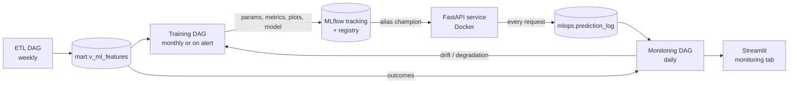

# Model lifecycle, monitoring and retraining criteria



## 1. Stages of a model version

| Stage | How it happens | Where you see it |
|---|---|---|
| Candidate | Every training run fits LR, RF and XGBoost | MLflow child runs |
| Registered | The best candidate (validation ROC-AUC) is registered as a new version of `readmission_risk_model` | MLflow → Models |
| Champion | Promoted if its test ROC-AUC ≥ current champion's ROC-AUC on the same test set − 0.002 | Alias `champion`, tag `promotion_decision` |
| Previous | The replaced champion keeps alias `previous` | Used for rollback |
| Served | The API loads `@champion` at start-up and on `POST /reload` (called automatically by the training DAG) | `GET /model-info` |

**Rollback:** in the MLflow UI, move the `champion` alias to the `previous` version, then run `curl -X POST http://localhost:8000/reload`.

## 2. What is monitored (daily DAG `readmission_model_monitoring`)

| Area | Measure | Source |
|---|---|---|
| Input-data quality | % of requests with out-of-range values or unseen categories; invalid requests rejected with HTTP 422 | API `dq_flags`, status `rejected` |
| Input drift | PSI of every feature vs. the champion's training profile | `mlops.prediction_log.features` vs `mlops.reference_profile` |
| Performance | ROC-AUC, precision, recall, F1 on predictions whose outcome is known | predictions joined to `mart.v_ml_features` labels |
| Calibration | Brier score, expected calibration error (ECE) | same |
| Subgroups | Recall / precision / ROC-AUC by gender, race and age group | same |
| Operations | Volume, error and rejection rate, p50/p95 latency | `mlops.prediction_log`, `GET /metrics` (Prometheus) |

Each day the DAG also scores a sample of the most recent encounters through the API, which simulates production traffic whose outcomes become known later.

## 3. Retraining criteria

| Trigger | Threshold | Action |
|---|---|---|
| Significant input drift | Any feature PSI ≥ **0.25** | **Retrain** |
| Performance degradation | Live ROC-AUC < champion test ROC-AUC − **0.05** | **Retrain** |
| Miscalibration | ECE > **0.10** | **Retrain** (re-fit the calibrator) |
| Schedule | Monthly (`@monthly`) | Retrain |
| Fairness gap | Recall gap between subgroups > **0.20** (groups with ≥ 100 rows and ≥ 20 readmissions) | Alert, manual review |
| Moderate drift | PSI 0.10–0.25 | Warning only |
| API errors | Error/rejection rate > **5 %** | Operational alert |
| API latency | p95 > **500 ms** for interactive requests | Operational alert |

**Cool-down:** an automatic retrain is triggered at most once every 7 days (`RETRAIN_COOLDOWN_DAYS`). Without this, persistent drift that new data can't fix would retrain the model every day.

**Retraining never deploys automatically without a check:** the new version becomes champion only if it is at least as good as the current one on the same test data.

All thresholds are in `ml/config.py`.

## 4. Known finding from the verification run
Even the newest real encounters show **drift** relative to the training period: `department` PSI ≈ 0.5 and `number_diagnoses` PSI ≈ 0.29. In the later years, many more specialties are unrecorded, and up to 16 diagnoses are coded instead of 9. Performance stays close to the test result (live ROC-AUC 0.659 vs 0.669), so this is mainly a *data-recording* change. It is a good example of why monitoring drift and performance separately matters.

## 5. Demonstrating the loop
```powershell
# 1. normal traffic and a monitoring run
docker compose exec airflow-scheduler python /opt/airflow/scripts/simulate_traffic.py --n 300
#    -> trigger readmission_model_monitoring in Airflow

# 2. drifted traffic (older patients, longer stays, more medications)
docker compose exec airflow-scheduler python /opt/airflow/scripts/simulate_traffic.py --n 2000 --drift
#    -> trigger the monitoring DAG again: PSI for age/LOS/medications rises,
#       the "decide" task picks trigger_retraining (if outside the cool-down)
```
To demo the automatic trigger right after a training run, set `RETRAIN_COOLDOWN_DAYS: "0"` in the `x-airflow-common` environment of `docker-compose.yml`, then run `docker compose up -d`.
